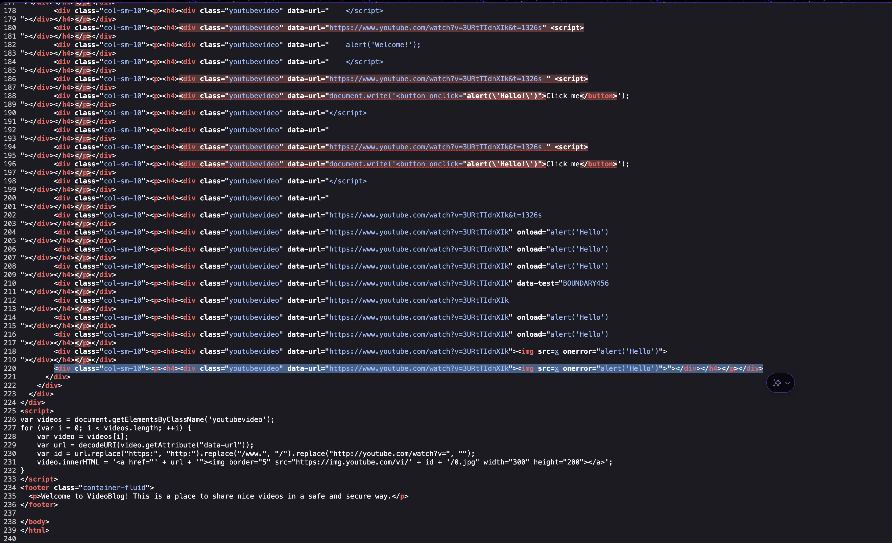
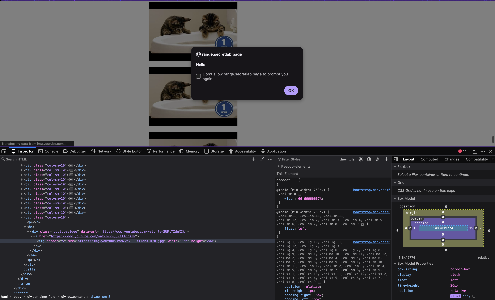
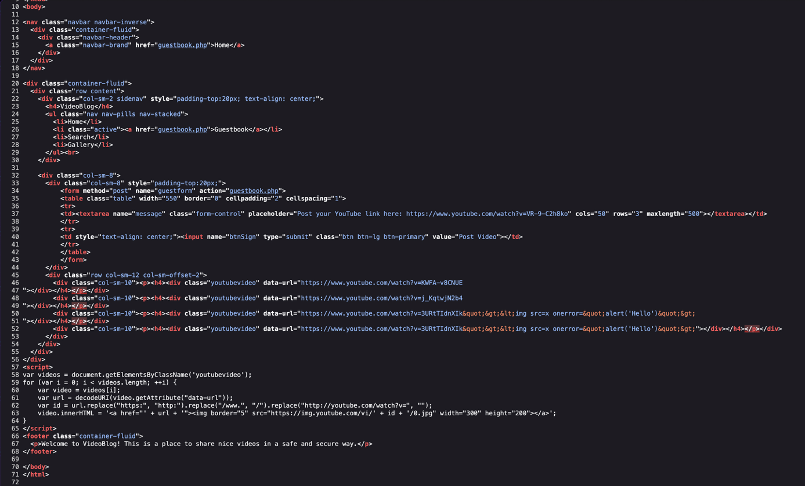
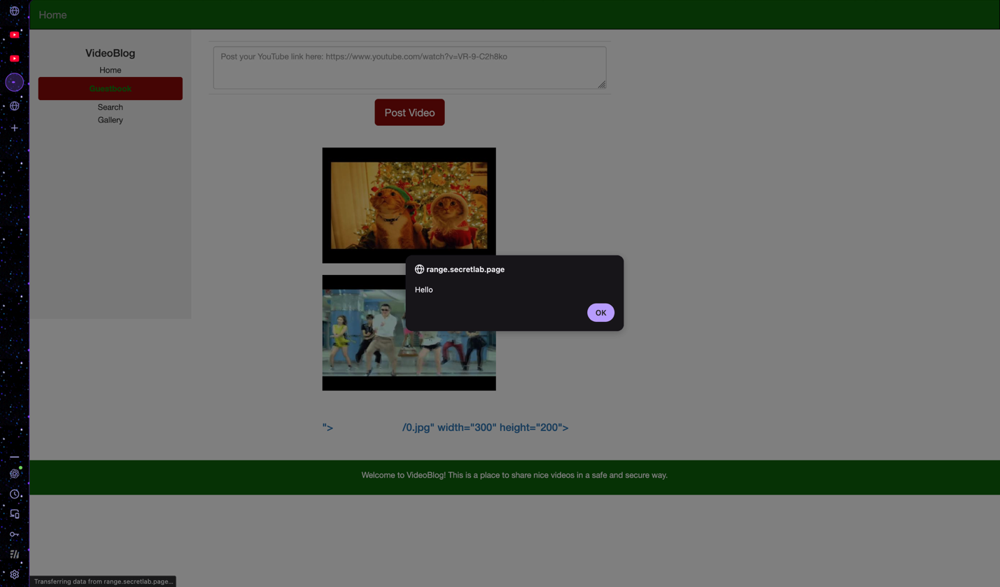
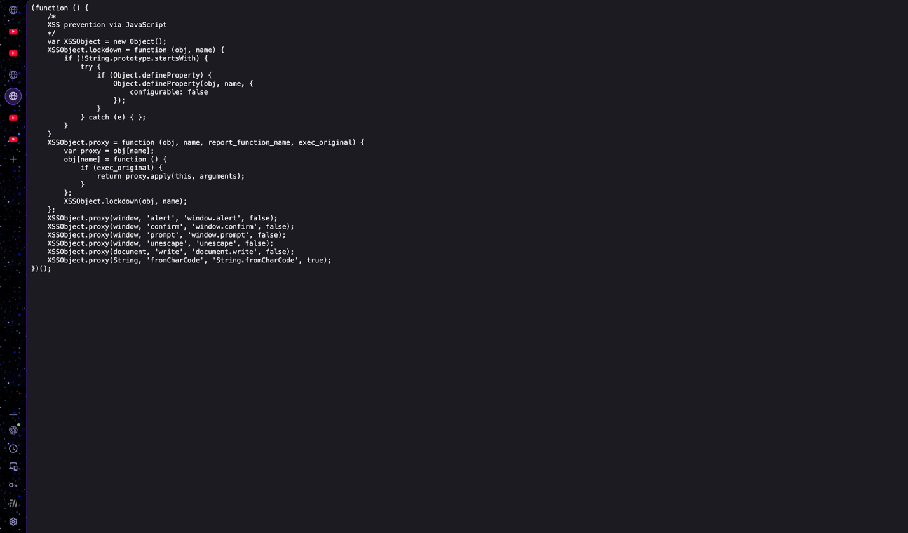
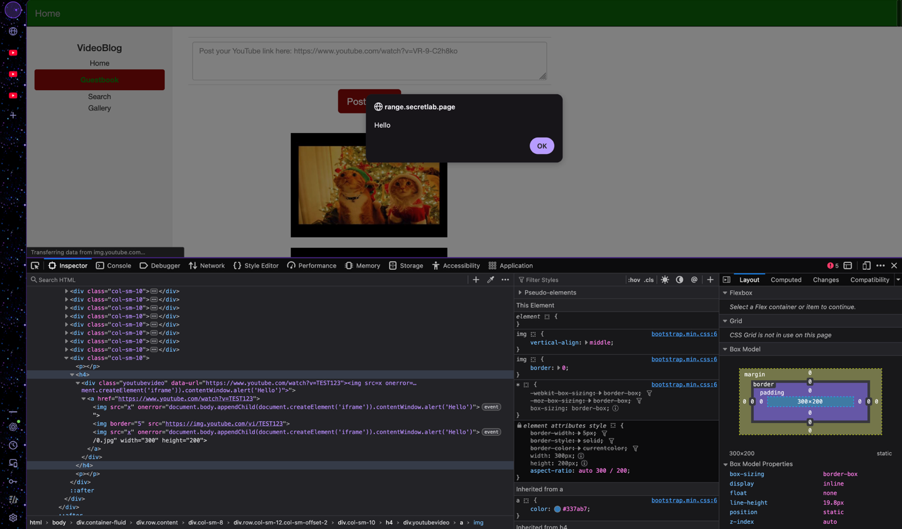

# Stored XSS Across Three Defensive Layers

A hands-on web security lab investigating how stored input becomes executable HTML, why initial output encoding can fail at a later DOM sink, and why replacing `alert()` does not prevent JavaScript execution.

**Author:** Samin Alikhani  
**Course:** CS 5713 — Practical Attack & Defense Techniques, Fall 2026  
**Tools:** Firefox, View Page Source, Inspector, and Console

## Local reproduction and implemented remediation

I extended this analysis with an independent PHP guestbook developed locally on my MacBook. It includes vulnerable and fixed versions, separate JSON storage, server-side URL validation, safe DOM construction, and repeatable HTTP regression tests. I confirmed the local payload persisted before remediation and checked rejection and normal functionality after the fixes.

**[Setup, implementation, test results, and Git workflow](docs/local-guestbook.md)** · [Fixed application](guestbook/index.php) · [Vulnerable demonstration](guestbook/vulnerable.php) · [Automated tests](tests/test_guestbook.py)

The course-lab report below is preserved separately; its evidence limits concern the original instructor-provided application.

## Overview

I tested three versions of an instructor-provided VideoBlog guestbook. Each version accepted a YouTube URL and displayed a video entry. My objective was to store an input that displayed a `Hello` alert when the guestbook was visited.

I started with normal input, traced where it appeared, and used markers to identify attribute boundaries before testing executable payloads. The three levels exposed different problems:

| Level | Defense or behavior examined | Recorded outcome |
| --- | --- | --- |
| L1 | Input embedded in server-rendered HTML attributes | An injected image error handler displayed `Hello`. |
| L2 | Initial output encoding using `htmlspecialchars()`, followed by client-side HTML construction | The same payload displayed `Hello` after the stored value was reused in `innerHTML`. |
| L3 | Additional processing and replacement of parent-window dialog functions | A separate failing image called an iframe window's `alert()` and displayed `Hello`. |

These outcomes come from my lab notes and screenshots. Fresh-visit verification limits are documented below; this write-up does not claim a new live retest.

## Scope

All testing described here concerns my instructor-assigned guestbooks in an authorized educational environment. Student-specific target URLs and my student ID are omitted from this public version. The payload URLs below are submitted input strings, not links to the vulnerable guestbooks.

## 1. Tracing input through the application

I first posted a normal YouTube URL and confirmed that its video appeared at the bottom of the page:

```text
https://www.youtube.com/watch?v=3URtTIdnXIk
```

Inspector showed the URL in several places:

- `data-url` held a value read by page JavaScript.
- `href` controlled the generated link destination.
- `src` held a thumbnail URL constructed from the extracted video ID.

I then submitted a marker:

```text
https://www.youtube.com/watch?v=3URtTIdnXIk&lab=MARKER123
```

The marker appeared in all three contexts. This established that the application carried extra input into both stored markup and generated attributes.

A useful distinction throughout the lab was **source versus DOM**. View Page Source showed the server's returned HTML. Inspector showed the browser's parsed DOM after JavaScript had modified it. The two views did not always contain the same elements.

## 2. L1 — Breaking out of an HTML attribute

### Boundary probes

I appended a quote and inspected the response. Three broken thumbnails were visible after the test, but I did not establish that the quote caused all three.

Next, I used a quote followed by a `data-test` attribute containing `BOUNDARY456`. Inspector showed that a new attribute had been created. My written notes use typographic quotes for that probe, so I do not treat that transcription as an exact, reproducible input.

### Successful payload

```text
https://www.youtube.com/watch?v=3URtTIdnXIk">
```

The payload worked through the following sequence:

1. `"` terminated the original quoted attribute value.
2. `>` ended the opening tag.
3. `` introduced a new image element.
4. The image request failed in the lab, triggering `onerror`.
5. The handler called `alert('Hello')`.

The active image markup was visible in the returned source, and the browser displayed the alert. My notes also state that the popup appeared on later visits, supporting a stored-XSS result.



*L1 source evidence. The final `img`/`onerror` markup is present in the server response; earlier trial fragments are also preserved.*



*The L1 browser displayed `Hello`.*

For this L1 payload, the immediate execution path was the server-rendered HTML breakout. It should not be attributed solely to the later thumbnail-building `innerHTML` assignment. That script can replace the container's contents after initial parsing, which explains why source evidence can differ from the final Inspector tree.

### Other recorded trials

The source screenshot also contains script-tag fragments, `document.write()`/button fragments, and `onload` attribute attempts. Their complete submitted inputs and individual outcomes were not preserved in the prose notes. I do not reconstruct them as complete payloads or label them successful. A button requiring a click would also need separate evaluation against the visit-triggered alert objective.

## 3. L2 — Encoding at one boundary did not protect the next

L2 added the `htmlspecialchars()` protection described in the assignment. I submitted the successful L1 payload again and compared the source with the rendered result.

```text
https://www.youtube.com/watch?v=3URtTIdnXIk">
```

The response showed HTML character references such as `&quot;`, `&gt;`, and `&lt;` around the stored payload. That is evidence that the initial output was encoded.



*The L2 response contains encoded input in `data-url`, followed by JavaScript that constructs HTML from the retrieved value.*

The vulnerable pattern was:

```javascript
var url = decodeURI(video.getAttribute("data-url"));
// The page derives a thumbnail ID from url, then concatenates
// url and that ID into an HTML string assigned to video.innerHTML.
```

This excerpt summarizes the relevant source operations; it is not a complete application listing.

The browser resolves HTML character references while parsing the original attribute. `getAttribute()` reads that resulting DOM value; it does not fetch the original PHP input and is not itself an HTML-entity decoder. The separate `decodeURI()` call handles URI escapes, not HTML entities.

When the script concatenated that value into a new HTML string and assigned it to `innerHTML`, the browser parsed it again. Characters that had been attribute data could now become markup. The injected image's error handler displayed `Hello`.



*The same input produced a `Hello` alert in L2.*

The lesson was not that `htmlspecialchars()` did nothing. It encoded the initial response, but the application subsequently reused the resulting DOM value in an unsafe HTML interpretation context.

## 4. L3 — Separating code execution from popup behavior

### Initial probes

After confirming normal video functionality, I submitted:

```text
https://www.youtube.com/watch?v=3URtTIdnXIkTEST123"'<>&
https://www.youtube.com/watch?v=TEST123" data-probe="CHECK456
https://www.youtube.com/watch?v=TEST123" onerror="alert('Hello')
https://www.youtube.com/watch?v=TEST123" onerror="alert('Hello')" x="
```

Each line represents a separate trial.

The attribute probe showed that an attribute could still be introduced. The direct-alert trials did not produce the desired popup. Adding `x="` attempted to absorb the generated suffix, but an error handler alone does not make an image fail.

I also moved the special characters before `TEST123` and observed different processing. The exact second input was not preserved. Visible characters in Inspector alone cannot establish whether the server encoded its response or identify L3's undisclosed server-side checks.

### Two separate failure conditions

Troubleshooting identified two independent issues:

1. **The event needed to fire.** A selected YouTube thumbnail had `naturalWidth: 120`, showing it had loaded. There was no image error to invoke its handler. Manually changing its source to a nonexistent resource produced a 404 and an iframe-based `Hello` alert. That was a diagnostic Console test, not proof of stored execution on a fresh visit.
2. **The called function needed to display the dialog.** The page loaded `js/js-overrides.js`, which replaced parent-window `alert`, `confirm`, and `prompt` functions. Its wrapper called the original function only when `exec_original` was true; `alert` was registered with false.



*The supplied script suppresses calls to selected parent-window functions. It does not replace the browser's image-error event system.*

A later attempt to inject a failing `src` alongside the iframe handler also failed: inspection showed that the injected source belonged to the anchor while the image retained its YouTube source. This motivated creating a separate image rather than relying on an existing thumbnail to fail.

### Successful payload

```text
https://www.youtube.com/watch?v=TEST123">
```

This input created its own failing image. Its handler created and appended an iframe, accessed its `contentWindow`, and called that window's `alert('Hello')`. In the observed lab environment, the new frame provided an accessible window whose alert function had not been replaced by the parent script.

I reported this exact input as working in the troubleshooting conversation and preserved the same payload and a popup screenshot in my notes.



*Final L3 result. Inspector shows separate image elements with the iframe-based alert handler.*

The DOM supports unsafe HTML reconstruction as a relevant execution path. The evidence does not isolate every possible server-versus-client execution path, so I do not assert an exact undocumented server filter.

## 5. Verification and evidence limits

| Claim | Supporting evidence | Remaining limit |
| --- | --- | --- |
| L1 injected executable markup | Active source markup and a `Hello` screenshot; notes report later-visit alerts | No separate screenshot tying a fresh visit to the final clean demonstration URL |
| L2 remained vulnerable after initial encoding | Encoded source, HTML reconstruction code, and `Hello` screenshot | No separate fresh-visit record or fresh-page reproduction |
| L3 iframe payload produced a popup | Exact payload in notes and chat, plus final alert/DOM screenshot | Final screenshot has Inspector open; no separate clean-visit record |

To verify persistence, the saved guestbook must display the alert on an ordinary reload or fresh visit without Console commands, manual DOM changes, or a video click. Reproduction on a fresh vulnerable instance is a separate check. Those checks should not be inferred solely from a popup screenshot.

Screenshots in this repository are taken from my lab notes. Browser chrome containing assigned URLs has been cropped from the public copies; the displayed page and code content has not been regenerated.

## 6. Security lessons and remediation

This lab reinforced three practical lessons:

- Stored input can escape its intended attribute context and introduce executable HTML.
- Encoding must be evaluated at every interpretation boundary. Initial response encoding does not make later `innerHTML` use safe.
- Suppressing `alert()` changes a visible symptom; it does not eliminate injected JavaScript execution.

A corrective design would validate the expected YouTube host and video ID, create elements using DOM methods, and set validated attributes without concatenating untrusted values into HTML. Any server-rendered HTML still needs encoding appropriate to its output context. These are proposed improvements, not fixes implemented or tested during this lab.
