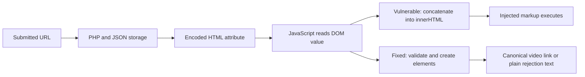
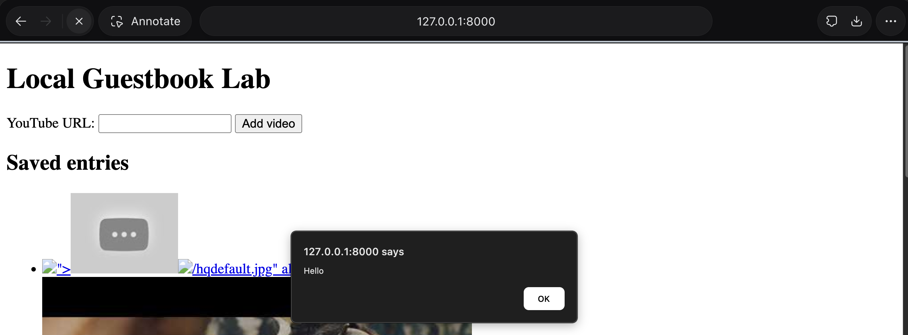
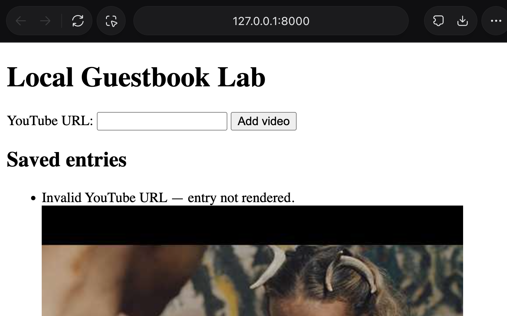

# Stored XSS: Secure Coding & Security Validation

I built a PHP video guestbook to reproduce stored cross-site scripting (XSS), trace its cause, and test a fix. The project pairs vulnerable and fixed versions with server-side URL validation, safe DOM rendering, and automated regression tests.

**Stack:** PHP · JavaScript · HTML · JSON · Python · Playwright · Git / GitHub

## Outcome

| Before | After |
| --- | --- |
| Stored input becomes executable markup through `innerHTML`. | DOM elements are created directly; submitted strings are never interpreted as HTML by the fixed renderer. |
| A saved image-error payload displays `Hello` on a later visit. | The tested legacy payload renders as an invalid-entry message without an alert. |
| Arbitrary nonempty input reaches JSON storage. | PHP rejects input outside the supported YouTube URL format before saving. |

**Results:** all five HTTP tests and three Chromium browser tests passed locally. Tests use temporary storage and their own localhost server. Manual checks also verified persistence, unchanged storage after rejection, and valid thumbnails. [Coverage and reproduction steps →](docs/validation.md)

## OWASP alignment

This project addresses **OWASP Top 10:2025 — A05: Injection**, specifically stored XSS (**CWE-79**), through URL validation, HTML output encoding, and safe DOM construction. [OWASP category reference](https://top10.owasp.org/2025/A05_2025-Injection/)

## Skills demonstrated

- **Vulnerability analysis:** traced submitted input through storage, encoded HTML, and JavaScript rendering.
- **Secure code review and remediation:** replaced `innerHTML` with DOM methods and built video links from validated IDs.
- **Control testing:** verified rejection of new payloads, safe handling of old entries, and normal functionality.
- **Risk communication:** assessed impact and remaining risks in a [threat model and review](docs/security-review.md).
- **Version control:** developed on a feature branch, reviewed staged changes, made focused commits, and merged through [pull request #1](https://github.com/Samin-Alikhani/Stored-XSS-Remediation-and-Validation/pull/1). [Development record →](docs/local-guestbook.md#git-workflow)

## Root cause and fix



PHP encodes the saved URL, but the vulnerable JavaScript later parses it as HTML through `innerHTML`. The fix validates new submissions and creates DOM elements directly, following [OWASP XSS prevention guidance](https://cheatsheetseries.owasp.org/cheatsheets/Cross_Site_Scripting_Prevention_Cheat_Sheet.html).

| Control | Implementation | Evidence |
| --- | --- | --- |
| Reject unsupported input before storage | [PHP validation](guestbook/index.php) accepts HTTPS YouTube watch URLs with an 11-character video ID. | HTTP and browser rejection checks; unchanged storage. |
| Keep output as data at the HTML boundary | PHP `htmlspecialchars()` for quoted attributes and text. | Legacy-payload response encoding test. |
| Avoid HTML reconstruction | `createElement`, validated attributes, `appendChild`, `replaceChildren`; `textContent` for rejection. | Browser tests assert no alert or injected event handler and retain the expected valid link. |
| Keep comparisons and data separate | [Vulnerable demonstration](guestbook/vulnerable.php), separate JSON files, ignored runtime data. | HTTP storage-isolation test. |

## Before and after evidence

### Vulnerable local reproduction



*The vulnerable guestbook executes the injected image-error handler and displays a `Hello` alert.*

### Fixed rendering



*The fixed renderer replaces an invalid saved entry with text while preserving a valid video thumbnail.*

## Prerequisites

| Component | Requirement |
| --- | --- |
| Application | PHP 8.1+, Git, and a modern browser. |
| HTTP tests | Python 3.10+; no additional Python packages. |
| Browser tests | Python 3.10+ with `venv` and `pip`, Playwright from `requirements-dev.txt`, and its Chromium browser. Installation commands are below. |
| Network | Internet access for cloning, installing test dependencies, and displaying live thumbnails. Browser tests block external thumbnail requests. |

Development and local validation used macOS with Homebrew PHP 8.5.12. The commands below use a macOS/Linux shell.

## Run the application

```bash
git clone https://github.com/Samin-Alikhani/Stored-XSS-Remediation-and-Validation.git
cd Stored-XSS-Remediation-and-Validation
mkdir -p storage
php -S 127.0.0.1:8000 -t guestbook
```

- Fixed application: <http://127.0.0.1:8000/>
- Intentionally vulnerable comparison: <http://127.0.0.1:8000/vulnerable.php>

Run on localhost and stop with Control+C. Saved entries stay outside the served directory.

Example input: `https://www.youtube.com/watch?v=bGpB9q6Oym0`. Short links and extra query parameters are not supported.

## Run the tests

Run the automated local HTTP checks:

```bash
python3 tests/test_guestbook.py
```

Install the browser-test dependencies and run the local Chromium checks:

```bash
python3 -m venv .venv
source .venv/bin/activate
python -m pip install -r requirements-dev.txt
python -m playwright install chromium
python tests/test_browser.py
```

[Detailed validation matrix and evidence →](docs/validation.md)

Tests run locally. The GitHub Actions file in `docs/ci/` is an **inactive template**, not a working CI pipeline.

## Project guide

| Resource | Purpose |
| --- | --- |
| [Security review](docs/security-review.md) | Threat model, impact assessment, control decisions, residual risks. |
| [Validation](docs/validation.md) | Automated and manual checks, reproduction steps, test scope. |
| [Development record](docs/local-guestbook.md) | Implementation chronology, original observations, Git workflow. |
| [Original investigation](docs/original-investigation.md) | Background analysis of three authorized course-lab defensive layers. |

## Scope and ownership

This local project grew from an authorized course investigation. I ran the development commands and manual checks with AI guidance; documentation and automated tests were also developed with AI assistance. See the [validation guide](docs/validation.md#evidence-provenance-and-limitations) and [security review](docs/security-review.md).
