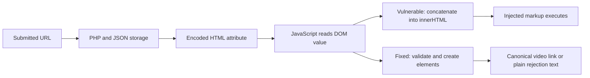

# Stored XSS: Secure Coding & Security Validation

An application security case study that traces a stored cross-site scripting vulnerability from root cause to implemented controls and repeatable regression tests.

I built a local PHP video guestbook, reproduced JavaScript execution from a saved URL, and remediated the unsafe rendering path with server-side URL validation and safe DOM construction. Vulnerable and fixed versions are preserved for comparison, alongside test results and a documented Git workflow.

**Stack:** PHP · JavaScript · HTML · JSON · Python · Playwright · Git / GitHub

## Outcome

| Before | After |
| --- | --- |
| Stored input becomes executable markup through `innerHTML`. | DOM elements are created directly; submitted strings are never interpreted as HTML by the fixed renderer. |
| A saved image-error payload displays `Hello` on a later visit. | The tested legacy payload renders as an invalid-entry message without an alert. |
| Arbitrary nonempty input reaches JSON storage. | PHP rejects input outside the supported YouTube URL format before saving. |

**Automated local validation:** five HTTP regression tests and three Chromium browser tests. The suites use disposable storage and a separate localhost server. Historical manual checks also cover fresh-visit execution, rejected-submission storage hashes, and valid thumbnail behavior. [Coverage and reproduction steps →](docs/validation.md)

## OWASP alignment

This project addresses **OWASP Top 10:2025 — A05: Injection**, specifically stored cross-site scripting (**CWE-79**). Implemented controls include server-side URL allowlisting, context-appropriate HTML encoding, and safe DOM construction, verified with HTTP and browser regression tests. [OWASP category reference](https://top10.owasp.org/2025/A05_2025-Injection/)

## Security engineering demonstrated

- **Vulnerability analysis:** followed input from POST submission through storage, HTML encoding, DOM attribute retrieval, and a second HTML interpretation boundary.
- **Secure code review and remediation:** removed an unsafe DOM sink, constrained accepted URLs, and built canonical destinations from validated video IDs.
- **Control testing:** checked both preventive validation and safe handling of legacy data, while preserving valid application behavior.
- **Risk communication:** distinguished demonstrated script execution from potential business impact and documented residual risks in a [threat model and review](docs/security-review.md).
- **Version control:** developed on a feature branch, reviewed staged changes, made focused commits, and merged through [pull request #1](https://github.com/Samin-Alikhani/Stored-XSS-Remediation-and-Validation/pull/1). [Development record →](docs/local-guestbook.md#git-workflow)

## Root cause and fix



Initial HTML encoding protects the original attribute boundary. It does not make a later `innerHTML` assignment safe. The remediation addresses both input acceptance and the DOM sink, consistent with [OWASP XSS prevention guidance](https://cheatsheetseries.owasp.org/cheatsheets/Cross_Site_Scripting_Prevention_Cheat_Sheet.html).

| Control | Implementation | Evidence |
| --- | --- | --- |
| Reject unsupported input before storage | [PHP validation](guestbook/index.php) accepts HTTPS YouTube watch URLs with an 11-character video ID. | HTTP and browser rejection checks; unchanged storage. |
| Keep output as data at the HTML boundary | PHP `htmlspecialchars()` for quoted attributes and text. | Legacy-payload response encoding test. |
| Avoid HTML reconstruction | `createElement`, validated attributes, `appendChild`, `replaceChildren`; `textContent` for rejection. | Browser tests assert no alert or injected event handler and retain the expected valid link. |
| Keep comparisons and data separate | [Vulnerable demonstration](guestbook/vulnerable.php), separate JSON files, ignored runtime data. | HTTP storage-isolation test. |

## Before and after evidence

### Vulnerable local reproduction


*The vulnerable guestbook executes the injected image-error handler and displays a `Hello` alert.*

### Fixed rendering


*The fixed renderer replaces an invalid saved entry with text while preserving a valid video thumbnail.*

## Prerequisites

| Component | Requirement |
| --- | --- |
| Application | PHP 8.1+, Git, and a modern browser. |
| HTTP tests | Python 3.10+; no additional Python packages. |
| Browser tests | Python 3.10+ with `venv` and `pip`, Playwright from `requirements-dev.txt`, and its Chromium browser. Installation commands are below. |
| Network | Internet access for cloning, installing test dependencies, and displaying live thumbnails. Browser tests block external thumbnail requests. |

Development and local validation used macOS with Homebrew PHP 8.5.12. The commands below use a macOS/Linux shell.

## Run the application

```bash
git clone https://github.com/Samin-Alikhani/Stored-XSS-Remediation-and-Validation.git
cd Stored-XSS-Remediation-and-Validation
mkdir -p storage
php -S 127.0.0.1:8000 -t guestbook
```

- Fixed application: <http://127.0.0.1:8000/>
- Intentionally vulnerable comparison: <http://127.0.0.1:8000/vulnerable.php>

Use localhost only. Stop the server with Control+C. Storage stays outside the served directory. Thumbnails require internet access; security tests block external thumbnail requests.

Supported submission example: `https://www.youtube.com/watch?v=bGpB9q6Oym0`. Short links and extra query parameters are deliberately outside the current submission policy.

## Run the tests

Run the automated local HTTP checks:

```bash
python3 tests/test_guestbook.py
```

Install the browser-test dependencies and run the local Chromium checks:

```bash
python3 -m venv .venv
source .venv/bin/activate
python -m pip install -r requirements-dev.txt
python -m playwright install chromium
python tests/test_browser.py
```

[Detailed validation matrix and evidence →](docs/validation.md)

The GitHub Actions configuration under `docs/ci/` is an **inactive template**. Completed functionality is automated local regression testing; hosted CI/CD is not implemented.

## Project guide

| Resource | Purpose |
| --- | --- |
| [Security review](docs/security-review.md) | Threat model, impact assessment, control decisions, residual risks. |
| [Validation](docs/validation.md) | Automated and manual checks, reproduction steps, test scope. |
| [Development record](docs/local-guestbook.md) | Implementation chronology, original observations, Git workflow. |
| [Original investigation](docs/original-investigation.md) | Background analysis of three authorized course-lab defensive layers. |

## Scope and ownership

An independent localhost XSS case study developed from an authorized course investigation with AI assistance. I ran the development commands and manual browser checks; completion work added documentation and automated local tests. The focus is stored-XSS remediation, with evidence boundaries and remaining application risks documented in the [validation guide](docs/validation.md#evidence-provenance-and-limitations) and [security review](docs/security-review.md).
