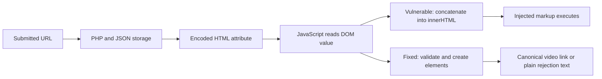

# Stored XSS: Reproduction, Remediation & Validation

An application security case study that traces a stored cross-site scripting vulnerability from root cause to implemented controls and repeatable regression tests.

I built a local PHP video guestbook, reproduced JavaScript execution from a saved URL, and remediated the unsafe rendering path with server-side URL validation and safe DOM construction. Vulnerable and fixed versions are preserved for comparison, alongside test results and a documented Git workflow.

**Stack:** PHP · JavaScript · HTML · JSON · Python · Playwright · Git / GitHub

## Outcome

| Before | After |
| --- | --- |
| Stored input becomes executable markup through `innerHTML`. | DOM elements are created directly; submitted strings are never interpreted as HTML by the fixed renderer. |
| A saved image-error payload displays `Hello` on a later visit. | The tested legacy payload renders as an invalid-entry message without an alert. |
| Arbitrary nonempty input reaches JSON storage. | PHP rejects input outside the supported YouTube URL format before saving. |

**Validation:** five HTTP regression tests and three Chromium browser tests. The suites use disposable storage and a separate localhost server. Historical manual checks also cover fresh-visit execution, rejected-submission storage hashes, and valid thumbnail behavior. [Coverage and reproduction steps →](docs/validation.md)

## Security engineering demonstrated

- **Vulnerability analysis:** followed input from POST submission through storage, HTML encoding, DOM attribute retrieval, and a second HTML interpretation boundary.
- **Secure code review and remediation:** removed an unsafe DOM sink, constrained accepted URLs, and built canonical destinations from validated video IDs.
- **Control testing:** checked both preventive validation and safe handling of legacy data, while preserving valid application behavior.
- **Risk communication:** distinguished demonstrated script execution from potential business impact and documented residual risks in a [threat model and review](docs/security-review.md).
- **Version control:** developed on a feature branch, reviewed staged changes, made focused commits, and merged through [pull request #1](https://github.com/Samin-Alikhani/Stored-XSS-Analysis-and-Defense-Bypass/pull/1). [Development record →](docs/local-guestbook.md#git-workflow)

## Root cause and fix



Initial HTML encoding protects the original attribute boundary. It does not make a later `innerHTML` assignment safe. The remediation addresses both input acceptance and the DOM sink, consistent with [OWASP XSS prevention guidance](https://cheatsheetseries.owasp.org/cheatsheets/Cross_Site_Scripting_Prevention_Cheat_Sheet.html).

| Control | Implementation | Evidence |
| --- | --- | --- |
| Reject unsupported input before storage | [PHP validation](guestbook/index.php) accepts HTTPS YouTube watch URLs with an 11-character video ID. | HTTP and browser rejection checks; unchanged storage. |
| Keep output as data at the HTML boundary | PHP `htmlspecialchars()` for quoted attributes and text. | Legacy-payload response encoding test. |
| Avoid HTML reconstruction | `createElement`, validated attributes, `appendChild`, `replaceChildren`; `textContent` for rejection. | Browser tests assert no alert or injected event handler and retain the expected valid link. |
| Keep comparisons and data separate | [Vulnerable demonstration](guestbook/vulnerable.php), separate JSON files, ignored runtime data. | HTTP storage-isolation test. |

## Before and after evidence

### Vulnerable local reproduction


*Execution before remediation, captured while the vulnerable implementation was still `index.php`. Persistence was checked separately; a single screenshot does not establish it.*

### Fixed rendering


*An existing invalid entry is replaced with text while a valid thumbnail remains. These are cropped development captures; the underlying results were not recreated.*

## Run the application

Requires PHP 8.1+ and Git. Tested during development with Homebrew PHP 8.5.12 on macOS. Repository access is required while it remains private.

```bash
git clone https://github.com/Samin-Alikhani/Stored-XSS-Analysis-and-Defense-Bypass.git
cd Stored-XSS-Analysis-and-Defense-Bypass
mkdir -p storage
php -S 127.0.0.1:8000 -t guestbook
```

- Fixed application: <http://127.0.0.1:8000/>
- Intentionally vulnerable comparison: <http://127.0.0.1:8000/vulnerable.php>

Use localhost only. Stop the server with Control+C. Storage stays outside the served directory. Thumbnails require internet access; security tests block external thumbnail requests.

Supported submission example: `https://www.youtube.com/watch?v=bGpB9q6Oym0`. Short links and extra query parameters are deliberately outside the current submission policy.

## Run the tests

HTTP checks need Python 3 and PHP, with no extra Python packages:

```bash
python3 tests/test_guestbook.py
```

Browser checks additionally use Playwright and Chromium:

```bash
python3 -m venv .venv
source .venv/bin/activate
python -m pip install -r requirements-dev.txt
python -m playwright install chromium
python tests/test_browser.py
```

[Detailed validation matrix and limitations →](docs/validation.md)

## Project guide

| Resource | Purpose |
| --- | --- |
| [Security review](docs/security-review.md) | Threat model, impact assessment, control decisions, residual risks. |
| [Validation](docs/validation.md) | Automated and manual checks, reproduction steps, test scope. |
| [Development record](docs/local-guestbook.md) | Implementation chronology, original observations, Git workflow. |
| [Original investigation](docs/original-investigation.md) | Background analysis of three authorized course-lab defensive layers. |

## Scope and ownership

This independent local reproduction grew from an authorized course investigation. The original university application was not modified. I ran the development commands and manual browser checks with AI guidance; later completion work added documentation and automated tests with AI assistance.

This is a focused XSS remediation case study. Authentication, CSRF protection, concurrent JSON updates, and production error handling remain outside the implemented controls. No payment system, customer data, or employer environment was tested. Potential impact beyond the observed alert is discussed as a threat scenario, not a demonstrated compromise.
