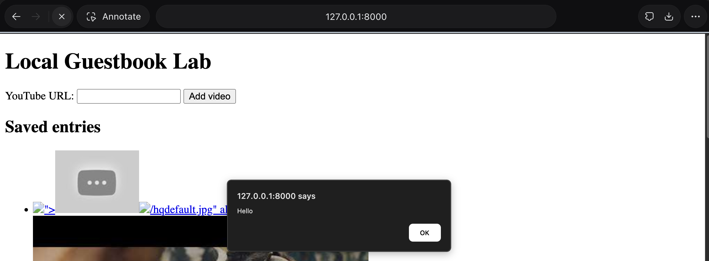
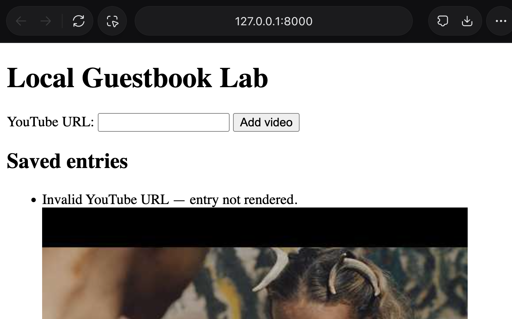

# Local Stored-XSS Reproduction, Remediation, and Validation

## Project scope

After analyzing the instructor-provided guestbooks, I built an independent PHP guestbook on my MacBook to reproduce the unsafe DOM rendering pattern and implement a fix. This application is my local reproduction; it is not the original university application or a patch to its server. The [original investigation](original-investigation.md) retains the course-lab evidence and its limits.

The project uses PHP, JavaScript, HTML, JSON file storage, Git, and GitHub. My development environment used Homebrew PHP 8.5.12 and Git 2.55.0.

## Run locally

Follow the [complete prerequisites and setup instructions](../README.md#prerequisites) in the README. The completed application is on `main`.

The server document root is `guestbook/`; JSON storage is outside it. The fixed page writes `storage/entries.json`; the vulnerable page writes `storage/vulnerable-entries.json`. Both files are created on submission and ignored by Git. Duplicate submissions are allowed. Entries display newest first.

## Vulnerability and remediation

The vulnerable page stores submitted text, encodes it into an HTML `data-url` attribute, then reads that attribute with JavaScript. It concatenates the value into an HTML string assigned to `innerHTML`. The browser parses that string as new markup, allowing an injected image error handler to execute.

The fixed page retains PHP HTML output encoding and adds two protections:

- PHP accepts only `https://youtube.com/watch?v=VIDEO_ID` or the `www` equivalent, with exactly eleven letters, digits, underscores, or hyphens in the ID. Extra parameters, short links, other hosts, and appended markup are rejected before storage.
- JavaScript validates the URL and video ID, constructs canonical link and thumbnail URLs, and uses `createElement`, `appendChild`, and `replaceChildren`. Invalid old entries display a text message. Submitted strings are no longer parsed through `innerHTML`.

Client-side rendering checks and server-side acceptance have different roles. PHP enforces the strict submission format; the DOM code safely handles values already present in storage.

## Manual browser validation — November 17, 2026

My local reproduction initially used `index.php` for the vulnerable page. After confirming execution, I preserved that implementation as `vulnerable.php` with separate storage and fixed the default page.

Test input:

```text
https://www.youtube.com/watch?v=bGpB9q6Oym0">
```

| Check | Observed result |
| --- | --- |
| Submit the payload before remediation | `Hello` popup appeared. |
| Fresh visit without another submission before remediation | Popup appeared again, confirming persistence in the local reproduction. |
| Load the previously stored payload after the rendering fix | No popup; invalid-entry text appeared. Valid thumbnails still displayed. |
| Submit the payload after PHP validation | Validation message appeared. SHA-256 hashes of the storage file before and after matched. |
| Submit a valid watch URL after validation | Thumbnail appeared at the top and persisted on a fresh visit. |
| Refresh after a successful submission | Entry count stayed unchanged; the POST/303/GET flow prevented refresh resubmission. |

Evidence provenance and coverage limits are consolidated in the [validation guide](validation.md#evidence-provenance-and-limitations).

See the [manual reproduction steps](validation.md#reproduce-manually) to repeat these checks.

## Local screenshot evidence



*The vulnerable renderer executes the injected image-error handler and displays `Hello`.*



*The fixed renderer replaces an invalid saved entry with a message and preserves a valid video thumbnail.*

## Automated regression checks

From the repository root:

```bash
python3 tests/test_guestbook.py
```

The suite copies the application to a temporary directory, starts its own PHP server on a temporary localhost port, creates separate JSON files, and removes them after testing. It does not use or reset the developer's stored entries.

Five tests cover valid persistence and refresh behavior; rejected payloads and malformed URLs without storage changes; array-shaped form input; HTML encoding of a legacy payload; and separate vulnerable-demo storage and redirects. All five passed during the November 17 completion review.

These HTTP tests do not execute JavaScript. The additional browser suite in `tests/test_browser.py` verifies vulnerable execution, fixed legacy-entry handling, and form rejection. See [validation instructions](validation.md) for setup and coverage limits.

## Git workflow

I developed on the `local-guestbook` feature branch, reviewed working and staged changes, and made focused commits for persistence, the vulnerable reproduction, and remediation. The application and supporting documentation were merged into `main` through [pull request #1](https://github.com/Samin-Alikhani/Stored-XSS-Remediation-and-Validation/pull/1). [Pull request #2](https://github.com/Samin-Alikhani/Stored-XSS-Remediation-and-Validation/pull/2) added the case-study structure and browser regression tests. Runtime JSON data is excluded through `.gitignore`.

## Limits and next improvements

This is a single-user educational reproduction. It has no authentication, CSRF protection, entry limits, or production-grade error handling. `LOCK_EX` protects each write but does not make the entire read/modify/write cycle safe for concurrent users. Corrupted JSON currently raises an exception. The URL policy intentionally supports a narrow watch-URL format. A production application would need broader design and testing beyond this XSS exercise.

Development was guided with AI assistance; I ran the local commands and manual browser checks. The completion review added automated HTTP regression tests and documentation.
